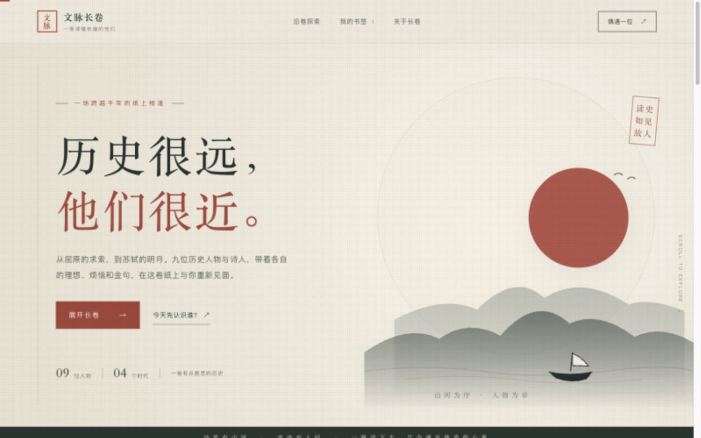

# 文脉长卷

> 翻开一卷山水，遇见九位仍在文字中发光的人。

## 1. 作品介绍与所选路线

**课程作业路线二：Agent 辅助编程；作品类型：视觉网站。**

文脉长卷是一座以中国古代文学人物为主题的线上展厅。访客沿着时代长卷认识屈原、司马迁、陶渊明、李白、杜甫、王安石、苏轼、李清照和辛弃疾：先浏览人物卡片，再展开人物手札读生平、作品与史料，最后进入人物专属的对话故事页。阅读从概览逐步走向细节，也可以随时返回长卷，继续遇见下一位人物。

网站延续纸张、淡墨和朱红印记的视觉语言，将长卷、手札和对话放进同一套阅读体验。故事采用轻松的旁白与情境化对白，让人物的经历和作品更容易走近读者。九位人物各有一张原创水墨风格插画，以服饰、姿态和相关物件表现人物气质；插画是艺术化创作，并非真实肖像或教材图片。

## 2. 功能与阅读方式

- **探索长卷：**按时代筛选，搜索人物、作品或时代，也可以随机遇见一位人物。
- **阅读手札：**在原有长卷页面内查看“卷内阅读”“细读一句”和“史料小注”，收藏人物，或切换到上一位、下一位。
- **深入了解：**从手札进入人物专属故事页。九篇故事各有三章，包含逐句对话、一次回应选择、卷末小结及作品原文链接。情境化对白与作品原句分别标示。
- **继续阅读：**故事页支持上一句、跳过本章、从头再读和返回长卷；每位人物都有可直接访问并分享的网址，例如 `?person=su-shi`。
- **保留阅读记录：**书签和最近阅读足迹保存在当前浏览器。页面也处理了无搜索结果、空书签、无效人物链接和插画加载失败等情况。

网站适配桌面与手机。故事页支持左右方向键操作；系统开启“减少动态效果”时，逐字呈现会被跳过。

## 3. 技术栈与项目架构

项目使用 **Vite 8、React 19、JavaScript 和 CSS**，无需账号或后端。首页的山水效果由 SVG 与 CSS 绘制；人物插画以 WebP 格式随项目提供。项目没有使用现成网站模板。

| 文件或目录 | 作用 |
| --- | --- |
| `src/figures.js` | 人物资料、作品原句与资料链接 |
| `src/stories.js` | 九篇故事的章节、对白、选项与小结 |
| `src/App.jsx` | 长卷首页、搜索筛选、书签、阅读足迹与页面导航 |
| `src/DetailPanel.jsx` | 人物手札及“深入了解”入口 |
| `src/StoryPage.jsx` | 故事阅读、回应选择与键盘操作 |
| `src/styles.css`、`src/detail.css`、`src/story.css` | 长卷、手札与故事页的样式 |
| `public/portraits/` | 九张原创水墨风格人物插画 |
| `vite.config.js` | 网站部署时使用的基础路径 |
| `.github/workflows/deploy.yml` | GitHub Pages 自动构建与发布 |
| `AI_USE.md` | 需求、Agent 工作、人工反馈和验证情况的记录 |

## 4. 运行方法

需要 **Node.js 22.12 或更新版本**和 npm。在项目根目录运行：

```bash
npm ci
npm run dev
```

打开终端显示的本地地址，通常为 `http://localhost:5173/wenmai-scroll/`。检查正式构建时运行：

```bash
npm run build
npm run preview
```

构建文件生成在 `dist/`。项目需要通过开发服务器或静态网站服务访问，直接双击 `index.html` 打开无法正常加载。

## 5. 功能检查、验证结果与已知问题

已在 Node.js 24.19 环境下完成 `npm run build`，并在桌面和 390 × 844 手机尺寸下检查页面。主要功能可按以下路径复查：

1. 在首页切换时代、搜索人物或作品；搜索不存在的词，确认出现空结果提示。
2. 点击任意人物卡片，阅读手札的三个部分；点击“深入了解”，确认进入对应人物的故事页。
3. 在故事页逐句阅读、选择回应并走到卷末小结；使用浏览器返回键回到长卷。直接打开并刷新 `?person=su-shi`，确认人物页仍可阅读。
4. 收藏人物并刷新页面，确认书签仍在；打开无效地址 `?person=unknown`，确认出现返回入口。
5. 在手机尺寸检查长卷、手札和故事页，确认内容可阅读且没有横向溢出。

本地检查中，九位人物的独立链接与对应插画均正常加载；苏轼篇已从开头读到小结。人物手札跳转、浏览器返回、收藏和无效人物链接也已检查。

**已知限制：**书签与阅读足迹只保存在当前浏览器，清除网站数据后会消失；作品原文链接需要联网。九篇故事尚未逐句完成独立的史实与文字校对。人物对白属于创作表达，不应视为历史人物原话；作品引文以页面中的“作品原句”标识为准。

## 6. 在线地址与效果截图

- [GitHub Pages 网站](https://ttaozhiming.github.io/wenmai-scroll/)
- [项目仓库](https://github.com/ttaozhiming/wenmai-scroll)



